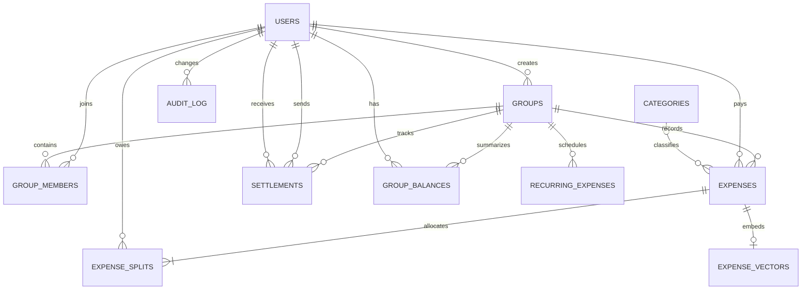

# SmartSplit Project Report

## Objectives

SmartSplit records shared group expenses, allocates each expense among participants, calculates each member's net position, and suggests a smaller set of payments that settles the same ledger. The application provides authenticated member and administrator workflows over a PostgreSQL accounting database, with optional Neo4j debt-graph synchronization and optional pgvector similarity search.

## Functional requirements

- Register, log in, maintain a cookie-backed session, update a profile, and log out.
- Create and browse groups; add/remove members subject to membership and balance rules; generate and accept invite links.
- Create, edit, search, filter, paginate, export and inspect group expenses. Supported split modes are equal, exact amounts, percentages and shares.
- Show original and simplified debts, record partial settlements, view settlement history and visualize the debt graph.
- Show user dashboard, activity, group and platform analytics, recurring expenses and an admin SQL demonstration.
- Enforce administrator and group membership/owner permissions on API operations, validate request data with Zod, and return consistent JSON errors.

Guests without accounts are not currently implemented. See `requirements-checklist.md` for remaining limitations.

## ER diagram

The diagram source and a compact DBML representation are in `er-diagram.md` and `schema.dbml`.

## Relational schema

PostgreSQL is the authoritative store. `users`, `groups`, `group_members`, `categories`, `expenses`, `expense_splits`, `settlements`, `audit_log`, `group_balances`, `recurring_expenses` and `expense_vectors` are defined in `../db/schema.sql`. `expense_vectors.embedding` is `real[]` in the default schema and changes to `vector(384)` when vector mode is enabled during initialization. Derived views are defined in `../db/views.sql`; functions and triggers are in the corresponding SQL files. All money is `numeric(12,2)`.

## Database choice and justification

**PostgreSQL** stores identities, memberships, expenses, split rows, settlements, audit events and calculated balances. These records have relational constraints and monetary invariants; expense creation and settlement need atomic multi-row transactions and concurrency control. Foreign keys, checks, deferred constraint triggers, row locks, views and indexes keep these invariants close to the data.

**Neo4j** is an optional projection for the derived member-to-member `OWES` network. Its graph model is useful for traversing and visualizing debt relationships, but it is not the source of truth for payments. A group sync merges nodes by id and rebuilds that group's `OWES` edges; PostgreSQL/TypeScript supplies the fallback plan when graph configuration or connectivity is unavailable.

**pgvector** is optional because semantic expense similarity is not required for accounting correctness. When installed and `ENABLE_VECTOR=true`, the schema stores 384-dimensional vectors and an HNSW cosine index. The default is disabled; vector setup requires the PostgreSQL pgvector extension. It is not used for balances or settlements.

## Data dictionary

Every base table column, SQL type, nullability, default and declared key/check/reference constraint is listed in `data-dictionary.md`. The executable definition remains `../db/schema.sql`, with optional vector-mode DDL in `../db/vector.sql`.

## SQL/NoSQL/vector implementation

- PostgreSQL DDL, transactional functions, validation/audit/balance triggers, reporting views, lookup indexes and full-text search are in `../db/`.
- `add_expense_with_splits`, `settle_up`, `get_group_balances`, `simplify_debts_preview` and `run_recurring_expenses` implement core database operations.
- `search_doc` is a generated English `tsvector`; the GIN index supports ranked expense text search.
- Neo4j projection and health handling are implemented in `../src/lib/sync.ts`; example Cypher is in `../neo4j/queries.cypher`.
- `../src/lib/embedding.ts` creates deterministic local vectors. Vector API operations are conditional on `ENABLE_VECTOR=true`; live pgvector operation is not verified in this report.
- `../scripts/db-init.ts` is deliberately destructive and drops/recreates `public`. It is an initialization/reset command, not a safe production migration.

## Important queries

The course query demonstrations are in `../db/advanced_queries.sql` and the admin-facing SQL demo is served by `/admin/sql-demo`. Important production query patterns include:

- Net balances: paid expense amount minus each participant's split, adjusted by settlements (`get_group_balances`).
- Full-text filtering and relevance ranking using `websearch_to_tsquery` and `ts_rank` (`src/app/api/groups/[groupId]/expenses/route.ts`).
- Simplified debts by matching debtors and creditors until both totals are exhausted (`simplify_debts_preview` and `src/lib/simplify.ts`).
- Window-function spend ranking and month-over-month analytics (`v_group_spend_ranking`, `src/app/api/analytics/route.ts`).
- Balance reconciliation comparing calculated balances with trigger-maintained rows (`v_balance_reconciliation`).

## System architecture

The UI is a Next.js App Router application with a shared authenticated dashboard layout. Route handlers under `src/app/api` authenticate the httpOnly `smartsplit_session` cookie, reload active user/role state from PostgreSQL, enforce group membership or admin/owner access, validate request payloads with Zod, and wrap multi-row writes in transactions. PostgreSQL remains the accounting source of truth. Neo4j receives derived group debt projections, and optional vector endpoints use PostgreSQL pgvector when enabled. Vitest covers session-token logic, allocation arithmetic, debt simplification, invite tokens and vector formatting.

## Application screenshots

Capture the exact routes and states listed in `SCREENSHOTS_TODO.md`. Include separate screenshots for role-dependent admin pages and the vector-disabled state; do not include passwords, session cookies or secret environment values.

## Testing results

The latest requested TypeScript check, Vitest run and production build output is recorded verbatim in `testing-results.md`. Database integration and live Neo4j/pgvector checks require configured services and are listed as unverified unless explicitly run. Detailed scenarios and their status are in `test-cases.md`.

## Conclusion

SmartSplit demonstrates relational accounting invariants, authenticated group workflows, split calculation, ledger simplification and an optional graph projection. The automated checks cover deterministic application logic. Database integration, screenshot capture, and optional Neo4j/pgvector deployments remain environment-dependent verification tasks; the checklist records these limits explicitly.
