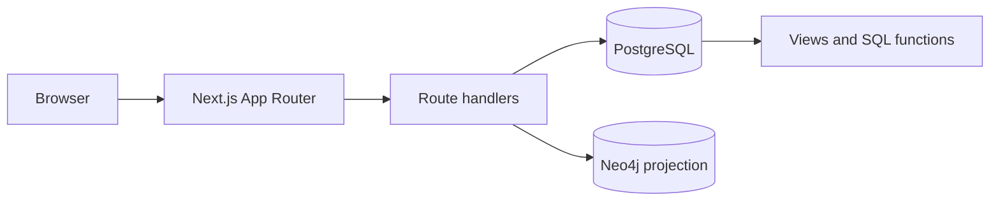

# Architecture

The intended request path is browser → Next.js route handler → validated, parameterized query → PostgreSQL. A graph sync can project group balances to Neo4j. Keep credentials in environment variables; do not place secrets in client bundles.
